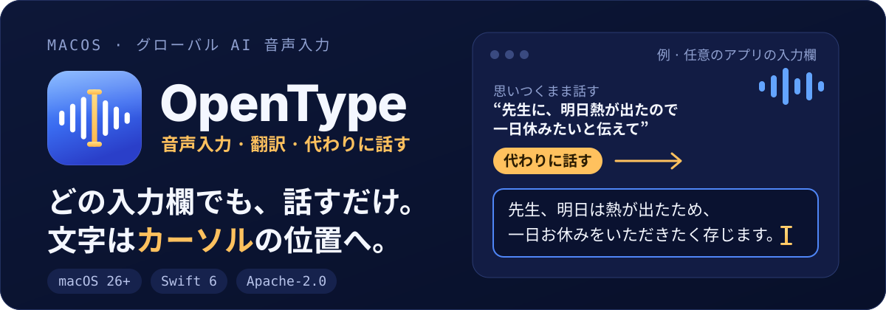
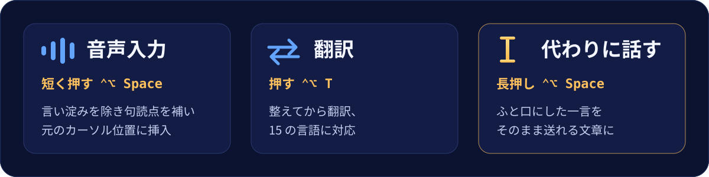

<p align="center">
  <a href="README.md">English</a> ·
  <a href="README.zh-Hans.md">简体中文</a> ·
  <a href="README.zh-Hant.md">繁體中文</a> ·
  <b>日本語</b> ·
  <a href="README.ko.md">한국어</a>
</p>

<p align="center">
  
</p>

<p align="center">
  <b>ショートカットを短く押して話し、もう一度短く押して終了。</b>音声の文字起こし、AI による補正（言い淀みの除去と句読点の補完）、元のカーソル位置への挿入までを一度に行います。<br>
  <sub>macOS 26.0+ · Swift 6 / SwiftUI / AppKit · Apache-2.0</sub>
</p>

<p align="center">
  <a href="#3-つの使い方">使い方</a> ·
  <a href="#インストールと初回設定">インストール</a> ·
  <a href="#操作">操作</a> ·
  <a href="#プライバシーとセキュリティ">プライバシー</a> ·
  <a href="docs/README.md">ドキュメント（英語）</a> ·
  <a href="OpenType%20PRD.md">製品要件（中国語）</a>
</p>

## 3 つの使い方

<p align="center">
  
</p>

- **音声入力**：話し終えると、言い淀みの除去と句読点の補完が自動で行われ、元の入力位置にテキストが挿入されます。
- **音声翻訳**：話した内容を整えてから目標言語に翻訳します。15 言語に対応し、オーバーレイ上で一時的に言語を切り替えられます。ポルトガル語（ブラジル／ポルトガル）と繁体字中国語（台湾／香港・マカオ）では、地域ごとの表現を選べます。
- **代わりに話す**：音声入力のショートカットを押し続け（約 0.45 秒で切り替わります）、押したまま話して、離すと終了します。モデルは誤りを直すだけでなく、あなたの言いたいことを汲み取り、具体化・補完・整理してから挿入します。「先生に、明日熱が出たので一日休みたいと伝えて」と言えば、丁寧で完結した欠席連絡になり、「このエラーの解決方法を聞いて」と言えば、目的・条件・期待がはっきりした質問文になります。話していない人名・数字・日付を作り出すことはなく、話の中の質問に答えることもありません。[ウェブ検索](#代わりに話すのウェブ検索)をオンにすると、調べた情報を仕上がりに反映できます。
- **翻訳して代わりに話す**：翻訳ショートカットを押し続けると同じ処理を行い、仕上がりは翻訳先の言語で直接書かれます（オーバーレイで言語や地域ごとの表現を一時的に切り替えられます）。ウェブ検索やページの読み取りなど、「代わりに話す」のすべての機能が使えます。
- **音声で書き換え**：まず任意のアプリでテキストを選択し、音声入力のショートカットを押して（または長押しして）修正内容を話します。例：「もっと柔らかい口調に」「日本語に翻訳して」「3つの要点にまとめて」「この JSON を Swift の struct に変換して」。選択したテキストと音声の指示がまとめてモデルに渡され、結果で選択範囲がそのまま置き換わります。テキストを選択していないときは通常の音声入力のままで、「設定 → 代わりに話す」でオフにできます。アクセシビリティ権限が必要で、アプリが選択範囲をシステムに公開している必要があります。書き換えに失敗した場合や、話している間に選択範囲が変わった場合は、テキストが上書きされることはありません。
- **文章ツール**：任意のアプリでテキストを選択して ⌃⌥ W（変更可能）を押すと、選択範囲の横に小さなフローティングパネルが開きます。元のアプリからフォーカスを奪うことはありません。校正（変更箇所をインライン表示、きれいな版への切り替えも可能）、書き換え、トーン（フレンドリー、プロフェッショナル、簡潔）、要約、重要ポイント、リスト、表、翻訳をワンクリックで実行でき、変更したい内容を一文（入力または音声）で伝えることもできます。何も選択していないときは「作成」が開き、一文からメール・投稿・メッセージ（種類・トーン・長さの 3 列の選択肢。各列に自由入力欄あり）を作ってカーソル位置に挿入します（プレーンテキスト、または「Markdown で生成」で Markdown）。結果は生成されながら表示され、「もっと短く」のようにさらに調整したり、コピー、再生成、文書への置き換えができ、置き換えたあとは ⌘Z で元に戻せます。「設定 → 文章ツール」で、オン／オフ、ショートカット、モデル、推論強度を個別に設定できます。アクセシビリティ権限が必要です。

## 特長

- **多言語 UI**：简体中文、繁體中文（台湾）、English、日本語、한국어。デフォルトではシステム言語に従い、システム言語がこの中にない場合は英語を使用します。「設定 → 一般」で手動選択もできます。
- **ショートカットを自由にカスタマイズ**：単一のキー、キーの組み合わせ、修飾キー単体（左右を区別。例：右 ⌥）、`fn` のいずれも使えます。
- **フォーカスを奪わない**：オーバーレイは非アクティブ型の `NSPanel` で、音量の波形と認識テキスト（確定済みのテキストと、薄く表示される未確定部分）をリアルタイムに表示します。
- **ASR と LLM を分離**：ASR は Alibaba Cloud Bailian の `qwen3-asr-flash-realtime` / `qwen-audio-3.1-asr-flash-message`（リアルタイムストリーミング。後者は途中結果のリアルタイム表示と、認識側での整形（任意）に対応）または DeepSeek（録音終了後に全体をアップロード）から選べます。LLM は OpenAI Responses、OpenAI Chat Completions、Anthropic Messages の 3 つのプロトコル用アダプターを内蔵し、サードパーティの OpenAI 互換サービスにも対応します。複数のプロファイルと 3 段階の処理レベル（生 / 標準 / 詳細整形）をサポートします。
- **失敗しても言葉を失わない**：LLM が失敗またはタイムアウトした場合は ASR の原文に自動でフォールバックできます。ASR が切断されても認識済みの内容はコピー用に保持されます。`Esc` でいつでもキャンセルでき、キャンセル時は何も挿入されません。
- **3 段階の挿入**：アクセシビリティによる直接書き込み → 貼り付けの擬似操作（クリップボードは自動でバックアップ・復元）→ オーバーレイからの手動コピー。パスワード欄、セキュア入力モード、切り替え後のアプリには書き込まず、自動で改行や送信も行いません。
- **本格的なメインウィンドウ**：ネイティブの SwiftUI による 5 タブのウィンドウ。ホーム（入力の統計とトークン使用量）、履歴（検索・コピー・削除に対応）、辞書、プリセット、設定。
- **プログラマー向けの辞書**：プログラミング全般の用語、Git、Swift / Python / JavaScript・TypeScript / Shell / SQL / HTML・CSS のキーワードとよく使う関数、さらに AI の概念（Agent Harness、MCP、RAG など）とベンダー・製品（OpenAI、Anthropic、DeepSeek など）を内蔵しています。辞書ごとにオン／オフでき、自分の項目（正しい表記とよくある聞き間違い）も追加できます。音声に辞書の語が出てくると正しい表記を AI に伝え、「自動置換」をオンにした項目は AI の処理より前に認識結果をそのまま修正するので、AI 整理をオフにした原文モードでも効きます。
- **プリセットとアプリ単位のルール**：固定のプロンプト 1 つではなく、複数のプリセット（日常の整形、日常のやり取り、ビジネスメール、コードと技術の質問、Terminal コマンド生成、または自作）を管理できます。プリセットごとにプロンプトを持ち、文末の句点を取る、半角の句読点を使う、指定した辞書パックを有効にする、といった設定もできます。対象のアプリはご自身で追加し（「アプリを追加」で「アプリケーション」フォルダが開きます）、アプリごとにプリセットを割り当てます。録音を始めるとき、OpenType は今使っているアプリを見て対応するプリセットを自動で選びます。例：Slack / WeChat では口語的で句点なし、Xcode / Cursor では半角句読点とプログラミング辞書、Terminal / iTerm2 ではそのまま実行できるシェルコマンド。デフォルトのプリセットはメニューバーで切り替えられ、オーバーレイでその 1 回だけ変更もできます。コマンドのプリセットは 1 行のテキストとして入力するだけで、Return は決して押しません。
- **プライバシー重視**：API キーは平文の JSON として `~/.opentype/credentials.json` に保存されます（権限 0600。アップグレード後にキーチェーンのパスワードを求められることはありません）。音声は保存せず、認識テキストはこの Mac の履歴にのみ残り（いつでもオフにしたり消去したりできます）、ログに音声やテキストの内容は含まれません。

## 処理の流れ

```
idle → connecting → recording → finalizing → processing → inserting → idle
```

3 種類のセッションはこのパイプラインを共有し、違いは最後の LLM のステップだけです。音声入力は補正と整形、翻訳は翻訳、「代わりに話す」は整形に加えて具体化を行います。

1. **開始**：ショートカットを短く押します。現在フォーカスのあるアプリと入力コントロールを記録し、オーバーレイを表示して音声の取り込みを始め（`AVAudioEngine`、16 kHz / モノラル / PCM16）、ASR にストリーミング送信します。
2. **終了**：もう一度短く押します。取り込みを止め、残りの音声と `session.finish` を送信し、最終的な文字起こしを待ってから LLM で整えます（生のモードではスキップ）。
3. **挿入**：結果を元の入力コントロールに書き戻し、オーバーレイは短く通知を出してから閉じます。

「代わりに話す」は起動方法が異なります。ショートカットを押した時点ではまず通常の音声入力として始まり、約 0.45 秒を超えて押し続けると「代わりに話す」に切り替わって押している間だけ話すモードになり、ショートカットを離すと録音が終了します。それより早く離した場合は通常の音声入力のままです。修飾キー単体のショートカット（fn など）では、長押しそのものがセッションの開始になります。

各セッションには一意のセッション ID があり、すべての非同期コールバックは最初にこれを検証します。処理中は新しいセッションを開始できません。

## インストールと初回設定

### 1. ビルド

macOS 26 SDK に対応した Xcode が必要です。

```bash
git clone https://github.com/KryptonGao/OpenType.git
cd OpenType
open OpenType.xcodeproj
```

Xcode で自分の署名チームを選んでそのまま実行するか、コマンドラインでビルドします。

```bash
xcodebuild -project OpenType.xcodeproj -scheme OpenType -configuration Release -destination 'platform=macOS' build
```

> 安定した開発者証明書での署名をおすすめします。ad-hoc 署名は再ビルドのたびに ID が変わるため、「アクセシビリティ / 入力監視」の許可が無効になります。

### 2. 権限の許可

初回起動後、「設定 → プライバシーと権限」で許可し、システム設定の「プライバシーとセキュリティ」で OpenType をオンにします。

| 権限 | 用途 |
|---|---|
| マイク | 音声の取り込み（初回の録音時にダイアログが表示されます） |
| アクセシビリティ | 他のアプリの入力欄へのテキスト書き込みと、貼り付けの擬似操作 |
| 入力監視 | グローバルショートカットの監視 |

許可するとショートカットが自動的に有効になります。スイッチがオンなのに未許可と表示される場合は「OpenType を再起動」をクリックしてください。それでも直らないときは、システム設定のリストから OpenType を削除して、もう一度追加します。

### 3. サービスの設定

- **音声認識**（設定 → 音声認識）：まずサービスを選びます。
  - Alibaba Cloud Bailian（リアルタイムストリーミング）：認識モデル（`qwen3-asr-flash-realtime` または `qwen-audio-3.1-asr-flash-message`）とリージョン（北京 / シンガポール）を選び、Workspace ID と API キーを入力します。「接続をテスト」で確認もできます。Qwen-Audio 3.1 を選ぶと「認識側での整形：フィラーと繰り返しを除去」を切り替えられます（後段の LLM がすでに処理するため、デフォルトはオフ）。カスタムの `wss://` アドレスにも対応します。
  - DeepSeek（録音全体を認識）：API キーだけで使えます。この API はストリーミングに対応しないため、録音中にリアルタイムのテキストは表示されず、終了後に WAV 全体をアップロードして結果を受け取ります。1 回のリクエストは最長 120 秒で、それより長い録音は自動で分割して認識します。
- **AI 処理**（設定 → AI 処理）：プロファイルを作成し、API 形式を選んで、Base URL、Model ID、API キーを入力します。「接続をテスト」で確認もできます。Base URL は `https` のみ使用でき、末尾の `/v1` や `/responses` などは正規化され、二重に付加されることはありません。プロファイルごとに推論の強さ（effort。空欄なら送信されません）も設定できます。
- 音声翻訳と「代わりに話す」はどちらも現在選択中のプロファイルを使用し、AI テキスト後処理をオフにしていたり生のモードを選んでいても、このモデルを呼び出します。「代わりに話す」は出力が長めなので、よくタイムアウトする場合はプロファイルのタイムアウト秒数を長くしてください。

## 操作

| 操作 | デフォルト |
|---|---|
| 音声入力 | `⌃⌥ Space` を短く押して開始、もう一度短く押して終了 |
| 代わりに話す | `⌃⌥ Space` を押し続け、オーバーレイに「代わりに話す」と表示されたら話し、離して終了 |
| 翻訳して代わりに話す | `⌃⌥ T` を押し続け、オーバーレイに「翻訳して代わりに話す」と表示されたら話し、離して終了 |
| 音声翻訳 | `⌃⌥ T` を押して開始、もう一度押して終了 |
| 文章ツール | `⌃⌥ W` を押してパネルを開く（Esc かもう一度押すと閉じます。「設定 → 文章ツール」で変更可能） |
| キャンセル | `Esc`（話している間も処理中も可。キャンセル時は何も挿入されません） |

- ショートカットは「設定 → 一般」で入力欄をクリックし、新しいキーを押して変更できます。翻訳ショートカットは「設定 → 翻訳」で変更または消去できます。
- 「設定 → 代わりに話す」で、長押しによる起動をオフにしたり、プロンプトを編集したりできます。
- 翻訳の目標言語はデフォルトでは設定から取得され、録音中にオーバーレイで一時的に切り替えることもできます。翻訳に失敗した場合は、未翻訳のテキストは挿入されず、認識原文がオーバーレイに残るのでコピーできます。
- 自動挿入ができない場合（パスワード欄、フォーカスの変化など）は、結果がオーバーレイに表示されるので「テキストをコピー」をクリックしてください。
- メニューバーのアイコンから、音声入力 / 翻訳のショートカットの確認、ショートカットの一時停止、権限状態の確認ができ、メインウィンドウ、履歴、設定も開けます。

**ショートカットについて**

- 修飾キー単体のショートカット（fn、右 ⌥ など）は「離したとき」に一度だけ作動し、押している間に他のキーやマウスの操作がなかった場合に限ります。これにより `⌘C` や `⌥` + クリックといった操作との衝突を避けています。軽くタップするだけで使えます。
- 修飾キーなしの通常の文字キーはショートカットが独占してしまうため、修飾キーとの組み合わせをおすすめします。`F1–F20` は影響を受けません。
- `Esc` はキャンセルキーとして予約されています。
- 長押しによる「代わりに話す」の起動は、キーの組み合わせ、単一のキー、修飾キー単体のショートカットのいずれでも有効です。翻訳ショートカットの長押しは「翻訳して代わりに話す」で、こちらもあらゆる種類のショートカットに対応します。
- `fn` を使う場合は、先に「システム設定 → キーボード」で、fn 単独押しのシステム動作を「何もしない」に変更してください。

### 代わりに話すのウェブ検索

DeepSeek のみ対応で、独立した API キーを使います。デフォルトはオフで、「設定 → 代わりに話す」でオンにして DeepSeek のキーを入力すると有効になります。

- **リクエスト**：「代わりに話す」と「翻訳して代わりに話す」は、「AI 処理」で選択したプロファイルを使わなくなり、常に `https://api.deepseek.com/chat/completions`、モデル `deepseek-flash` にリクエストし、DeepSeek のサーバー側ツール `deepseek_web_search` を宣言します。検索とページの読み取りはどちらも DeepSeek のサーバー側で完了するため、クライアント側でツール呼び出しをループさせる必要はなく、検索するかどうかはモデルが判断します。
- **検索の積極度**：思考モード（DeepSeek の多段階の「ディープサーチ」。より積極的に検索します）を有効にし、ストリーミングリクエストを使います。スライダーで調整できます（0–100%、デフォルトは 80%）。

  | 範囲 | 動作 |
  |---|---|
  | 0% | オフと同じ |
  | 1–33% | 控えめ。思考モードなし |
  | 34–66% | 標準 |
  | 67–100% | 積極的 |

- **フィードバック**：タイムアウトは 180 秒で固定です。検索中はオーバーレイに「「…」を検索中 · N 件の結果を取得 · M 件のページを読み取り」とリアルタイムで表示され、挿入後に「ウェブ検索を実行：検索 N 回、合計 M 件の結果」または「モデルはウェブ検索を行いませんでした」と通知されます。
- **料金**：DeepSeek のウェブツールの価格で別途課金されます。
- **失敗時**：キーが未入力の場合はエラーになり、黙って別のモデルに切り替わることはありません。

## プライバシーとセキュリティ

- 録音は、選択した音声認識サービス（Alibaba Cloud Bailian のリアルタイムストリーミング、または録音終了後に全体をアップロードする DeepSeek）に送信され、文字起こしのテキストは設定した LLM サービスに送信されます。それ以外のネットワークリクエストは一切ありません。
- API キーは平文の JSON として `~/.opentype/credentials.json`（ディレクトリは 0700、ファイルは 0600）に保存されます。UI には「保存済み」としか表示されず、読み戻すことはありません。キーが `UserDefaults`、ログ、エラーメッセージに書き込まれることもありません。旧バージョンがキーチェーンに残したキーは、初回起動時に自動で移行されます。
- 証明書を検証する HTTPS / WSS のみ受け付けます。Workspace ID は形式チェックされ、キーは、それから生成された Alibaba Cloud のドメイン、または明示的に入力したカスタムの `wss://` アドレスにのみ送信されます。
- 生の音声をディスクに書き込むことはありません。認識および整形後のテキストは、デフォルトでこの Mac の `~/Library/Application Support/OpenType/history.json` に保存され（アップロードはされません）、「履歴」ページで保存をオフにしたり消去したりできます。ホームの統計で使うのは、回数、文字数、時間、トークン数だけです。診断ログはデフォルトでオフで、オンにしても各段階の所要時間しか記録しません。

## 開発

<details>
<summary><b>プロジェクト構成</b></summary>

```
OpenType/
├── App/            アプリのエントリポイント、AppDelegate、グローバルオブジェクト
├── Core/           セッションのステートマシンとコーディネーター、文字起こしアグリゲーター
├── Services/
│   ├── Audio/      AVAudioEngine による取り込み、リサンプリング、チャンク分割
│   ├── ASR/        Bailian リアルタイム認識の WebSocket クライアント、DeepSeek 全体認識クライアント
│   ├── LLM/        3 つのプロトコルアダプター、プロンプト（整形 / 翻訳 / 代わりに話す）、エラーマッピング
│   ├── Hotkey/     CGEventTap によるグローバルショートカット（長押し検出を含む）とショートカット設定
│   ├── Insertion/  3 段階のテキスト挿入
│   └── Permissions/ 権限の検出とガイド
├── Storage/        SettingsStore（UserDefaults）、CredentialStore（`~/.opentype/credentials.json`）
├── UI/             メニューバー、オーバーレイ、設定ウィンドウ
└── Util/           診断ログ
OpenTypeTests/      ユニットテスト
Design/             アプリアイコンとメニューバーアイコンのソース（SVG）
```

</details>

<details>
<summary><b>テストの実行</b></summary>

```bash
xcodebuild -project OpenType.xcodeproj -scheme OpenType -destination 'platform=macOS' test
```

テストの対象は、文字起こしの集約、ASR 設定と `session.update` の内容、3 つの LLM プロトコルのリクエストとレスポンスの解析およびエラーマッピング、ショートカットのステートマシンと長押し検出、設定の保存、そして偽の音声 / ASR / LLM / 挿入コンポーネントで駆動するエンドツーエンドのセッションフロー（成功、フォールバック、キャンセル、各種の失敗、さらに翻訳と「代わりに話す」）です。

</details>

## ロードマップ

- 辞書のインポート／エクスポート、辞書を使った音声認識の補正
- より多くの音声モデル / ローカル ASR
- あらゆる利用シーンでの互換性検証（Safari / Chrome / VS Code / Electron / チャット / フルスクリーン / 複数ディスプレイ / 入力ソースの切り替え）と、Developer ID 署名・公証

対象外：アカウントとクラウド同期、サブスクリプション課金、自前の推論サービス、macOS 以外のプラットフォーム、複数人の会議と話者分離。

製品要件の詳細は [OpenType PRD.md](OpenType%20PRD.md)（中国語）を参照してください。

## ライセンス

[Apache License 2.0](LICENSE)
