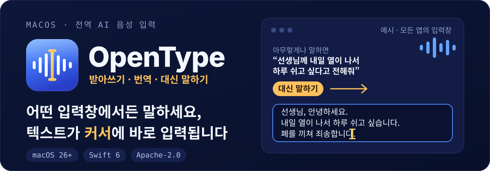
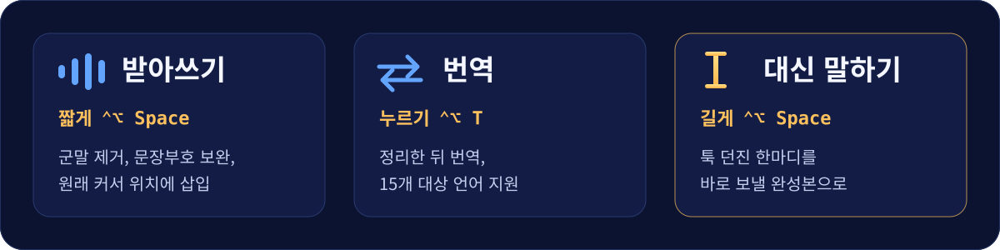

<p align="center">
  <a href="README.md">English</a> ·
  <a href="README.zh-Hans.md">简体中文</a> ·
  <a href="README.zh-Hant.md">繁體中文</a> ·
  <a href="README.ja.md">日本語</a> ·
  <b>한국어</b>
</p>

<p align="center">
  
</p>

<p align="center">
  <b>단축키를 짧게 눌러 말하고, 다시 짧게 눌러 끝냅니다.</b> 음성 받아쓰기, AI 교정(군말 제거와 문장부호 보완), 원래 커서 위치에 삽입까지 한 번에 처리합니다.<br>
  <sub>macOS 26.0+ · Swift 6 / SwiftUI / AppKit · Apache-2.0</sub>
</p>

<p align="center">
  <a href="#세-가지-사용법">사용법</a> ·
  <a href="#설치-및-첫-설정">설치</a> ·
  <a href="#사용">사용</a> ·
  <a href="#개인정보-보호-및-보안">개인정보 보호</a> ·
  <a href="docs/README.md">문서(영어)</a> ·
  <a href="OpenType%20PRD.md">제품 요구사항(중국어)</a>
</p>

## 세 가지 사용법

<p align="center">
  
</p>

- **받아쓰기**: 말을 마치면 군말을 없애고 문장부호를 넣은 뒤, 원래 입력하던 위치에 텍스트를 삽입합니다.
- **음성 번역**: 말한 내용을 먼저 정리한 다음 대상 언어로 번역합니다. 15개 언어를 지원하며 오버레이 창에서 언어를 임시로 바꿀 수 있습니다. 포르투갈어(브라질 / 포르투갈)와 번체 중국어(대만 / 홍콩·마카오)는 지역별 표현을 선택할 수 있습니다.
- **대신 말하기**: 받아쓰기 단축키를 누른 채 유지하고(약 0.45초 뒤에 전환됩니다), 누른 상태로 말한 뒤 손을 떼면 종료됩니다. 모델은 오류를 고치는 데 그치지 않고 하려는 말의 의도를 파악해 구체화·보완·정리한 뒤 삽입합니다. "선생님께 내일 열이 나서 하루 쉬고 싶다고 전해줘"라고 말하면 완결되고 정중한 결석 메시지가 되고, "이 오류 어떻게 해결하는지 물어봐 줘"라고 말하면 목표·조건·기대가 분명한 질문이 됩니다. 말하지 않은 사람 이름, 숫자, 날짜를 지어내지 않으며, 말 속에 담긴 질문에 답하지도 않습니다. [웹 검색](#대신-말하기의-웹-검색)을 켜면 찾은 자료를 결과물에 반영할 수 있습니다.
- **번역해서 대신 말하기**: 번역 단축키를 누른 채 유지하면 같은 일을 하되, 결과물이 번역 대상 언어로 바로 작성됩니다(오버레이 창에서 언어와 지역별 표현을 임시로 바꿀 수 있음). 웹 검색, 웹페이지 읽기 등 '대신 말하기'의 모든 기능을 쓸 수 있습니다.

## 특징

- **다국어 인터페이스**: 简体中文, 繁體中文(대만), English, 日本語, 한국어. 기본값은 시스템 언어를 따르며, 시스템 언어가 이 중에 없으면 영어를 사용합니다. '설정 → 일반'에서 직접 선택할 수도 있습니다.
- **단축키 완전 사용자 지정**: 단일 키, 키 조합, 보조 키 단독(좌우 구분, 예: 오른쪽 ⌥), `fn` 모두 가능합니다.
- **포커스를 빼앗지 않음**: 오버레이 창은 비활성형 `NSPanel`이며, 음량 파형과 인식된 텍스트(확정된 텍스트 + 흐리게 표시되는 미확정 부분)를 실시간으로 보여 줍니다.
- **ASR과 LLM 분리**: ASR은 알리바바 클라우드 Bailian의 `qwen3-asr-flash-realtime` / `qwen-audio-3.1-asr-flash-message`(실시간 스트리밍이며, 후자는 실시간 중간 결과와 선택적인 인식 단계 다듬기를 지원) 또는 DeepSeek(녹음이 끝난 뒤 전체를 업로드) 중에서 고를 수 있습니다. LLM은 OpenAI Responses, OpenAI Chat Completions, Anthropic Messages 세 가지 프로토콜 어댑터를 내장하고 있으며 서드파티 OpenAI 호환 서비스도 지원합니다. 여러 프로필과 3단계 처리 수준(원본 / 표준 / 심층 정리)을 지원합니다.
- **실패해도 말이 사라지지 않음**: LLM이 실패하거나 시간 초과되면 ASR 원문으로 자동 대체할 수 있습니다. ASR 연결이 끊겨도 이미 인식된 내용은 복사할 수 있도록 보존됩니다. `Esc`로 언제든 취소할 수 있으며, 취소하면 아무 텍스트도 삽입되지 않습니다.
- **3단계 삽입**: 손쉬운 사용으로 직접 쓰기 → 붙여넣기 시뮬레이션(클립보드는 자동으로 백업·복원) → 오버레이 창에서 직접 복사. 비밀번호 입력란, 보안 입력 모드, 전환된 앱에는 쓰지 않으며, 자동으로 Return을 누르거나 전송하지도 않습니다.
- **정식 메인 창**: 네이티브 SwiftUI 4개 탭 창으로, 홈(입력 통계와 토큰 사용량), 기록(검색·복사·삭제 가능), 사전, 설정으로 구성됩니다.
- **프로그래머를 위한 사전**: 프로그래밍 일반 용어, Git, Swift / Python / JavaScript·TypeScript / Shell / SQL / HTML·CSS의 키워드와 자주 쓰는 함수, 그리고 AI 개념(Agent Harness, MCP, RAG 등)과 업체·제품(OpenAI, Anthropic, DeepSeek 등)이 기본 제공됩니다. 사전별로 켜고 끌 수 있고, 직접 항목(올바른 표기와 자주 잘못 들리는 말)을 추가할 수도 있습니다. 음성에 사전의 단어가 나오면 AI에게 올바른 표기를 알려 주고, “자동 바꾸기”를 켠 항목은 AI 처리 전에 인식 결과를 바로 고치므로 AI 정리를 끈 원문 모드에서도 동작합니다.
- **개인정보 보호 우선**: API 키는 평문 JSON으로 `~/.opentype/credentials.json`에 저장됩니다(권한 0600, 업그레이드 후 키체인 비밀번호 창이 뜨지 않음). 오디오는 저장하지 않고, 인식된 텍스트는 이 Mac의 기록에만 남으며(언제든 끄거나 지울 수 있음), 로그에는 음성이나 텍스트 내용이 포함되지 않습니다.

## 작동 흐름

```
idle → connecting → recording → finalizing → processing → inserting → idle
```

세 가지 세션은 이 파이프라인을 공유하며, 마지막 LLM 단계만 다릅니다. 받아쓰기는 교정과 정리, 번역은 번역, '대신 말하기'는 정리에 더해 구체화를 수행합니다.

1. **시작**: 단축키를 짧게 누릅니다. 현재 포커스가 있는 앱과 입력 컨트롤을 기록하고, 오버레이 창을 띄운 뒤 오디오 수집(`AVAudioEngine`, 16 kHz / 모노 / PCM16)을 시작해 ASR로 스트리밍합니다.
2. **종료**: 다시 짧게 누릅니다. 수집을 멈추고 남은 오디오와 `session.finish`를 보낸 뒤 최종 전사를 기다리고, LLM이 이를 정리합니다(원본 모드에서는 건너뜀).
3. **삽입**: 결과를 원래 입력 컨트롤에 다시 쓰고, 오버레이 창은 잠깐 안내를 표시한 뒤 닫힙니다.

'대신 말하기'는 시작 방식이 다릅니다. 단축키를 누르면 먼저 일반 받아쓰기로 시작하고, 약 0.45초 넘게 계속 누르고 있으면 '대신 말하기'로 전환되어 누르고 있는 동안만 말하는 방식이 되며, 단축키에서 손을 떼면 녹음이 끝납니다. 그보다 일찍 떼면 일반 받아쓰기로 유지됩니다. 보조 키 단독 단축키(fn 등)는 길게 누르는 것 자체가 세션의 시작입니다.

모든 세션에는 고유한 세션 ID가 있으며 모든 비동기 콜백은 이를 먼저 검증합니다. 처리 중에는 새 세션을 시작할 수 없습니다.

## 설치 및 첫 설정

### 1. 빌드

macOS 26 SDK를 지원하는 Xcode가 필요합니다.

```bash
git clone https://github.com/KryptonGao/OpenType.git
cd OpenType
open OpenType.xcodeproj
```

Xcode에서 본인의 서명 팀을 선택한 뒤 바로 실행하거나, 명령줄로 빌드합니다.

```bash
xcodebuild -project OpenType.xcodeproj -scheme OpenType -configuration Release -destination 'platform=macOS' build
```

> 안정적인 개발자 인증서로 서명하는 것을 권장합니다. ad-hoc 서명은 다시 빌드할 때마다 ID가 바뀌어 시스템이 '손쉬운 사용 / 입력 모니터링' 권한을 무효화합니다.

### 2. 권한 허용

처음 실행한 뒤 '설정 → 개인정보 보호 및 권한'에서 권한을 허용하고, 시스템 설정의 '개인정보 보호 및 보안'에서 OpenType을 켭니다.

| 권한 | 용도 |
|---|---|
| 마이크 | 음성 수집(처음 녹음할 때 대화상자가 나타납니다) |
| 손쉬운 사용 | 다른 앱의 입력창에 텍스트를 쓰고 붙여넣기를 시뮬레이션 |
| 입력 모니터링 | 전역 단축키 감지 |

권한을 허용하면 단축키가 자동으로 활성화됩니다. 스위치가 켜져 있는데도 허용되지 않은 것으로 표시되면 'OpenType 다시 시작'을 누르세요. 그래도 해결되지 않으면 시스템 설정 목록에서 OpenType을 삭제한 뒤 다시 추가합니다.

### 3. 서비스 설정

- **음성 인식**(설정 → 음성 인식): 먼저 서비스 제공자를 선택합니다.
  - 알리바바 클라우드 Bailian(실시간 스트리밍): 인식 모델(`qwen3-asr-flash-realtime` 또는 `qwen-audio-3.1-asr-flash-message`)과 리전(베이징 / 싱가포르)을 선택하고 Workspace ID와 API 키를 입력합니다. '연결 테스트'로 확인할 수도 있습니다. Qwen-Audio 3.1을 선택하면 '인식 단계 다듬기: 군말과 반복어 제거'를 켜고 끌 수 있습니다(뒤따르는 LLM이 이미 처리하므로 기본값은 꺼짐). 사용자 지정 `wss://` 주소도 지원합니다.
  - DeepSeek(전체 녹음 인식): API 키만 있으면 됩니다. 이 API는 스트리밍을 지원하지 않으므로 녹음 중에는 실시간 텍스트가 없고, 종료 후 전체 WAV를 업로드하여 결과를 받습니다. 요청 한 번은 최대 120초이며, 더 긴 녹음은 자동으로 나누어 인식합니다.
- **AI 처리**(설정 → AI 처리): 프로필을 새로 만들고 API 형식을 선택한 뒤 Base URL, Model ID, API 키를 입력합니다. '연결 테스트'로 확인할 수도 있습니다. Base URL은 `https`만 허용하며, 끝의 `/v1`, `/responses` 등은 정규화되어 중복으로 붙지 않습니다. 프로필별로 추론 강도(effort, 비워 두면 보내지 않음)도 지정할 수 있습니다.
- 음성 번역과 '대신 말하기'는 모두 현재 선택된 프로필을 사용하며, AI 텍스트 후처리를 껐거나 원본 모드를 선택해도 이 모델을 호출합니다. '대신 말하기'는 출력이 길어 시간 초과가 자주 발생하면 프로필의 시간 제한(초)을 늘리세요.

## 사용

| 동작 | 기본 방식 |
|---|---|
| 받아쓰기 | `⌃⌥ Space`를 짧게 눌러 시작하고, 다시 짧게 눌러 종료 |
| 대신 말하기 | `⌃⌥ Space`를 누른 채 오버레이 창에 '대신 말하기'가 표시되면 말하고, 손을 떼면 종료 |
| 번역해서 대신 말하기 | `⌃⌥ T`를 누른 채 오버레이 창에 '번역해서 대신 말하기'가 표시되면 말하고, 손을 떼면 종료 |
| 음성 번역 | `⌃⌥ T`를 눌러 시작하고, 다시 눌러 종료 |
| 취소 | `Esc`(말하는 중이든 처리 중이든 가능하며, 취소하면 아무 텍스트도 삽입되지 않음) |

- 단축키는 '설정 → 일반'에서 입력란을 클릭하고 새 키를 직접 눌러 바꿀 수 있습니다. 번역 단축키는 '설정 → 번역'에서 변경하거나 지울 수 있습니다.
- '설정 → 대신 말하기'에서 길게 눌러 실행하는 기능을 끄거나 프롬프트를 수정할 수 있습니다.
- 번역 대상 언어는 기본적으로 설정에서 가져오며, 녹음 중에 오버레이 창에서 임시로 바꿀 수도 있습니다. 번역에 실패하면 번역되지 않은 텍스트는 삽입되지 않으며, 인식 원문이 오버레이 창에 남아 복사할 수 있습니다.
- 자동 삽입이 불가능할 때(비밀번호 입력란, 포커스가 바뀐 경우 등)에는 결과가 오버레이 창에 표시되므로 '텍스트 복사'를 누르면 됩니다.
- 메뉴 막대 아이콘에서 받아쓰기 / 번역 단축키 확인, 단축키 일시 중지, 권한 상태 확인을 할 수 있고, 메인 창, 기록, 설정도 열 수 있습니다.

**단축키에 관하여**

- 보조 키 단독 단축키(fn, 오른쪽 ⌥ 등)는 '뗄 때' 한 번만 작동하며, 누르고 있는 동안 다른 키나 마우스 조작이 없어야 합니다. `⌘C`나 `⌥` + 클릭 같은 동작과 충돌하지 않도록 하기 위해서이며, 가볍게 한 번 탭하면 됩니다.
- 보조 키 없는 일반 문자 키는 단축키가 독점하므로 보조 키와 함께 쓰기를 권장합니다. `F1–F20`은 영향을 받지 않습니다.
- `Esc`는 취소 키로 예약되어 있습니다.
- 길게 눌러 '대신 말하기'를 실행하는 기능은 키 조합, 단일 키, 보조 키 단독 단축키 모두에서 동작합니다. 번역 단축키를 길게 누르면 '번역해서 대신 말하기'가 실행되며, 이 역시 모든 종류의 단축키에서 동작합니다.
- `fn`을 사용하려면 먼저 '시스템 설정 → 키보드'에서 fn만 눌렀을 때의 시스템 동작을 '아무 동작 안 함'으로 바꾸세요.

### 대신 말하기의 웹 검색

DeepSeek만 지원하며 별도의 API 키를 사용합니다. 기본값은 꺼짐이며, '설정 → 대신 말하기'에서 켜고 DeepSeek 키를 입력하면 적용됩니다.

- **요청**: '대신 말하기'와 '번역해서 대신 말하기'는 더 이상 'AI 처리'에서 선택한 프로필을 쓰지 않고, 항상 `https://api.deepseek.com/chat/completions`에 모델 `deepseek-flash`로 요청하며 DeepSeek 서버 측 `deepseek_web_search` 도구를 선언합니다. 검색과 웹페이지 읽기는 모두 DeepSeek 서버에서 이루어지므로 클라이언트가 도구 호출을 반복할 필요가 없고, 검색 여부는 모델이 결정합니다.
- **검색 적극도**: 생각 모드(DeepSeek의 다단계 '딥 서치'로, 더 적극적으로 검색함)를 켜고 스트리밍 요청을 사용합니다. 슬라이더로 조절할 수 있습니다(0–100%, 기본값 80%).

  | 범위 | 동작 |
  |---|---|
  | 0% | 끈 것과 같음 |
  | 1–33% | 보수적, 생각 모드 없음 |
  | 34–66% | 보통 |
  | 67–100% | 적극적 |

- **피드백**: 시간 제한은 180초로 고정입니다. 검색하는 동안 오버레이 창에 '"…" 검색 중 · 결과 N건 찾음 · 웹페이지 M개 읽음'이 실시간으로 표시되고, 삽입 후에는 '웹 검색 완료: 검색 N회, 총 M건의 결과' 또는 '모델이 웹 검색을 하지 않았습니다'라고 알려 줍니다.
- **과금**: DeepSeek 웹 도구 요금으로 별도 과금됩니다.
- **실패**: 키를 입력하지 않았으면 오류가 표시되며, 조용히 다른 모델로 바꾸지 않습니다.

## 개인정보 보호 및 보안

- 녹음은 선택한 음성 인식 서비스(알리바바 클라우드 Bailian 실시간 스트리밍, 또는 녹음이 끝난 뒤 전체를 업로드하는 DeepSeek)로 전송되고, 전사된 텍스트는 설정한 LLM 서비스로 전송됩니다. 그 밖의 네트워크 요청은 전혀 없습니다.
- API 키는 평문 JSON으로 `~/.opentype/credentials.json`(디렉터리 0700, 파일 0600)에 저장됩니다. 화면에는 '저장됨'만 표시되며 키를 다시 읽어 오지 않습니다. 키는 `UserDefaults`, 로그, 오류 메시지에 기록되지 않습니다. 이전 버전이 키체인에 남긴 키는 처음 실행할 때 자동으로 이전됩니다.
- 인증서를 검증하는 HTTPS / WSS만 허용합니다. Workspace ID는 형식을 검증하며, 키는 이로부터 생성된 알리바바 클라우드 도메인 또는 직접 입력한 사용자 지정 `wss://` 주소로만 전송됩니다.
- 원본 오디오는 디스크에 기록하지 않습니다. 인식 및 정리된 텍스트는 기본적으로 이 Mac의 `~/Library/Application Support/OpenType/history.json`에 저장되며(업로드되지 않음), '기록' 페이지에서 저장을 끄거나 지울 수 있습니다. 홈 통계는 횟수, 글자 수, 시간, 토큰 수만 사용합니다. 진단 로그는 기본값이 꺼짐이며, 켜더라도 각 단계의 소요 시간만 기록합니다.

## 개발

<details>
<summary><b>프로젝트 구조</b></summary>

```
OpenType/
├── App/            앱 진입점, AppDelegate, 전역 객체
├── Core/           세션 상태 머신과 코디네이터, 전사 집계기
├── Services/
│   ├── Audio/      AVAudioEngine 수집, 리샘플링, 청크 분할
│   ├── ASR/        Bailian 실시간 인식 WebSocket 클라이언트, DeepSeek 전체 인식 클라이언트
│   ├── LLM/        세 가지 프로토콜 어댑터, 프롬프트(정리 / 번역 / 대신 말하기), 오류 매핑
│   ├── Hotkey/     CGEventTap 전역 단축키(길게 누름 감지 포함)와 단축키 설정
│   ├── Insertion/  3단계 텍스트 삽입
│   └── Permissions/ 권한 확인 및 안내
├── Storage/        SettingsStore(UserDefaults), CredentialStore(`~/.opentype/credentials.json`)
├── UI/             메뉴 막대, 오버레이 창, 설정 창
└── Util/           진단 로그
OpenTypeTests/      단위 테스트
Design/             앱 아이콘과 메뉴 막대 아이콘 원본(SVG)
```

</details>

<details>
<summary><b>테스트 실행</b></summary>

```bash
xcodebuild -project OpenType.xcodeproj -scheme OpenType -destination 'platform=macOS' test
```

테스트는 전사 집계, ASR 설정과 `session.update` 내용, 세 가지 LLM 프로토콜의 요청·응답 파싱과 오류 매핑, 단축키 상태 머신과 길게 누름 감지, 설정 저장, 그리고 가짜 오디오 / ASR / LLM / 삽입 컴포넌트로 구동하는 엔드투엔드 세션 흐름(성공, 대체, 취소, 각종 실패, 그리고 번역과 '대신 말하기')을 다룹니다.

</details>

## 로드맵

- 여러 프롬프트 프리셋, 사전 가져오기·내보내기, 사전을 이용한 음성 인식 보정
- 앱 단위 규칙
- 더 많은 음성 모델 / 로컬 ASR
- 모든 사용 환경에서의 호환성 검증(Safari / Chrome / VS Code / Electron / 메신저 / 전체 화면 / 다중 디스플레이 / 입력기 전환)과 Developer ID 서명 및 공증

범위 밖: 계정과 클라우드 동기화, 구독 결제, 자체 추론 서비스, macOS 외 플랫폼, 다자간 회의와 화자 분리.

제품 요구사항은 [OpenType PRD.md](OpenType%20PRD.md)(중국어)를 참고하세요.

## 라이선스

[Apache License 2.0](LICENSE)
