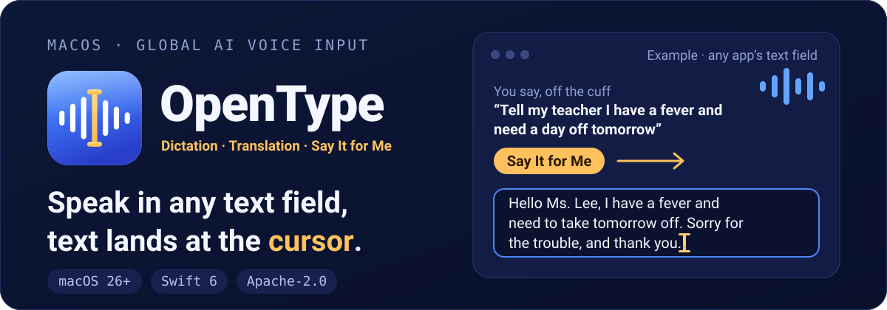
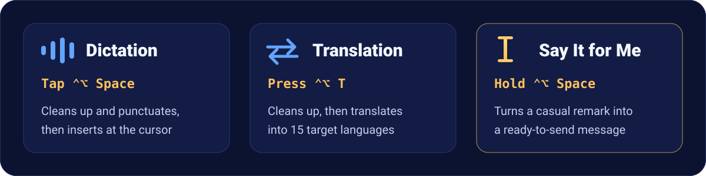

<p align="center">
  <b>English</b> ·
  <a href="README.zh-Hans.md">简体中文</a> ·
  <a href="README.zh-Hant.md">繁體中文</a> ·
  <a href="README.ja.md">日本語</a> ·
  <a href="README.ko.md">한국어</a>
</p>

<p align="center">
  
</p>

<p align="center">
  <b>Tap a shortcut to speak, tap again to finish.</b> Speech recognition, AI cleanup (filler words removed, punctuation added) and insertion at the original cursor, all in one step.<br>
  <sub>macOS 26.0+ · Swift 6 / SwiftUI / AppKit · Apache-2.0</sub>
</p>

<p align="center">
  <a href="#three-ways-to-use-it">Modes</a> ·
  <a href="#installation-and-first-run-setup">Install</a> ·
  <a href="#usage">Usage</a> ·
  <a href="#privacy-and-security">Privacy</a> ·
  <a href="docs/README.md">Documentation</a> ·
  <a href="OpenType%20PRD.md">Product requirements (Chinese)</a>
</p>

## Three ways to use it

<p align="center">
  
</p>

- **Dictation**: when you finish speaking, filler words are removed and punctuation is added, then the text is inserted where you were typing.
- **Voice translation**: what you say is cleaned up and then translated into the target language. 15 languages are supported; you can switch language temporarily in the overlay, and Portuguese (Brazil / Portugal) and Traditional Chinese (Taiwan / Hong Kong & Macau) offer regional wording.
- **Say It for Me**: hold the dictation shortcut (it kicks in after about 0.45 seconds), speak while holding, and release to finish. The model does more than fix errors: it works out what you mean, then refines, completes and organizes it before inserting. Say “Tell my teacher I have a fever and need a day off tomorrow” and you get a complete, polite leave request; say “Ask how to fix this error” and you get a question with the goal, conditions and expectations spelled out. It never invents names, numbers or dates you did not mention, and it does not answer the questions in what you said. You can turn on [web search](#web-search-for-say-it-for-me) so the result draws on what it finds.
- **Translate & Say It for Me**: hold the translation shortcut to do the same thing, but the finished text is written directly in the translation target language (you can switch language and regional wording temporarily in the overlay). Everything “Say It for Me” can do, including web search and page reading, is available.
- **Voice Rewrite**: select some text in any app first, then press the dictation shortcut (or hold it) and say what to change, such as “make the tone softer”, “translate to Japanese”, “summarize in three bullet points” or “turn this JSON into a Swift struct”. The selected text and your spoken instruction go to the model together, and the result replaces the selection in place. Without a selection it is ordinary dictation; it can be turned off under “Settings → Say It for Me”. Needs the Accessibility permission, and the app must expose its selection to the system. If the rewrite fails, or the selection changes while you speak, your text is never overwritten.
- **Writing Tools**: select text in any app and press ⌃⌥ W (customizable) to open a small floating panel beside the selection, without taking focus from the app. Proofread (shown as inline changes you can switch to a clean version), Rewrite, tone (Friendly, Professional, Concise), Summary, Key Points, List, Table and Translate are one click away, or describe the change you want in a sentence, typed or spoken. With nothing selected it opens Compose, which writes an email, post or message from one sentence (type, tone and length, each with a free-text option) and inserts it at the cursor (plain text, or Markdown with “Generate Markdown”). Results stream in as they are written and can be refined (“make it shorter”), copied, regenerated, and replaced into the document, where ⌘Z undoes it. It has its own switch, shortcut, model and reasoning effort under “Settings → Writing Tools”. Needs the Accessibility permission.

## Features

- **Multilingual interface**: 简体中文, 繁體中文 (Taiwan), English, 日本語 and 한국어. It follows the system language by default, falls back to English if the system language is not among them, and can be set manually under “Settings → General”.
- **Fully customizable shortcuts**: a single key, a key combination, a lone modifier key (left and right are distinguished, e.g. right ⌥), or `fn`.
- **Never steals focus**: the overlay is a non-activating `NSPanel` that shows a live volume waveform and the recognized text (confirmed text plus a lighter, not-yet-stable tail).
- **ASR and LLM are decoupled**: for ASR choose Alibaba Cloud Bailian `qwen3-asr-flash-realtime` / `qwen-audio-3.1-asr-flash-message` (real-time streaming; the latter adds live interim results and optional recognizer-side polishing) or DeepSeek (uploads the whole recording after you stop). The LLM side has built-in adapters for the OpenAI Responses, OpenAI Chat Completions and Anthropic Messages protocols and works with third-party OpenAI-compatible services; multiple profiles and three processing levels (Raw / Standard / Deep cleanup) are supported.
- **Never lose your words**: if the LLM fails or times out it can fall back to the raw ASR text; if ASR disconnects, what was already recognized is kept for copying; `Esc` cancels at any time and nothing is inserted.
- **Three-tier insertion**: direct write through Accessibility → simulated paste (the clipboard is backed up and restored automatically) → manual copy from the overlay. It never writes into password fields, secure input mode, or an app you have switched away from, and never presses Return or submits for you.
- **A proper main window**: a native SwiftUI window with five tabs: Home (typing stats and token usage), History (searchable, copy, delete), Dictionary, Presets and Settings.
- **Dictionary for programmers**: built-in packs for general coding terms, Git, the keywords and common functions of Swift / Python / JavaScript & TypeScript / Shell / SQL / HTML & CSS, plus AI concepts (Agent Harness, MCP, RAG…) and vendors and products (OpenAI, Anthropic, DeepSeek…). Each pack can be switched on or off, and you can add your own entries (correct spelling plus how it is often misheard). When your speech mentions dictionary words, the AI is told how to spell them, and entries with Auto-Replace are fixed in the recognized text before the AI runs, so it also works in Raw mode.
- **Presets and per-app rules**: manage several prompt presets (Everyday Clean-up, Casual Chat, Work Email, Code & Tech Questions, Terminal Commands, or your own) instead of one fixed prompt. Each preset has its own prompt and can drop the final full stop and switch on dictionary packs. You choose the apps yourself (**Add App** opens the Applications folder) and give each one a preset. When a recording starts, OpenType looks at the app you are in and picks that app's preset, for example casual and without a final full stop in Slack / WeChat, the coding packs in Xcode / Cursor, or a ready-to-run shell command in Terminal / iTerm2. Switch the default preset from the menu bar, or change it for a single recording in the overlay. A command preset only types the command, one line, and never presses Return.
- **Privacy first**: API keys are stored as plaintext JSON in `~/.opentype/credentials.json` (mode 0600, no more Keychain password prompts after upgrades); audio is never saved; recognized text lives only in the local history (which you can turn off or clear at any time); logs contain no speech or text.

## How it works

```
idle → connecting → recording → finalizing → processing → inserting → idle
```

All three kinds of session share this pipeline; they differ only in the final LLM step: dictation cleans up, translation translates, and “Say It for Me” cleans up and elaborates.

1. **Start**: tap the shortcut. The current focused app and input control are recorded, the overlay appears and audio capture begins (`AVAudioEngine`, 16 kHz / mono / PCM16), streamed to the ASR.
2. **Finish**: tap again. Capture stops, the remaining audio and `session.finish` are sent, the final transcript is awaited, and then the LLM tidies it up (skipped in Raw mode).
3. **Insert**: the result is written back to the original input control, and the overlay closes after a brief confirmation.

“Say It for Me” is triggered differently: pressing the shortcut first starts ordinary dictation, and if you keep holding past about 0.45 seconds it is upgraded to “Say It for Me” and becomes hold-to-talk; releasing the shortcut ends the recording. Release earlier and it stays ordinary dictation. For a modifier-only shortcut (such as fn), the long press itself starts the session.

Every session has a unique session ID that all asynchronous callbacks check first; a new session cannot start while one is processing.

## Installation and first-run setup

### 1. Build

Requires Xcode with the macOS 26 SDK.

```bash
git clone https://github.com/KryptonGao/OpenType.git
cd OpenType
open OpenType.xcodeproj
```

Pick your own signing team in Xcode and run, or build from the command line:

```bash
xcodebuild -project OpenType.xcodeproj -scheme OpenType -configuration Release -destination 'platform=macOS' build
```

> Sign with a stable developer certificate. An ad-hoc signature changes identity on every rebuild, which makes macOS invalidate the Accessibility / Input Monitoring grants.

### 2. Grant permissions

After the first launch, grant permissions under “Settings → Privacy & Permissions”, and turn OpenType on in System Settings → Privacy & Security:

| Permission | Purpose |
|---|---|
| Microphone | Capture speech (a prompt appears the first time you record) |
| Accessibility | Write text into other apps’ input fields and simulate paste |
| Input Monitoring | Listen for global shortcuts |

Shortcuts take effect automatically once permissions are granted. If a switch is on but still shows as not granted, click “Restart OpenType”; if that does not help, remove OpenType from the System Settings list and add it again.

### 3. Configure the services

- **Speech Recognition** (Settings → Speech Recognition): pick a provider first.
  - Alibaba Cloud Bailian (real-time streaming): choose the recognition model (`qwen3-asr-flash-realtime` or `qwen-audio-3.1-asr-flash-message`) and region (Beijing / Singapore), enter your Workspace ID and API key, and optionally click “Test Connection”. With Qwen-Audio 3.1 you can toggle “Recognizer-side polishing: remove filler words and repetitions” (off by default, since the LLM step already does this). A custom `wss://` address is also supported.
  - DeepSeek (whole-recording recognition): only an API key is needed. This API does not stream, so there is no live text while you record; when you finish, the whole WAV is uploaded and the result returned. A single request is limited to 120 seconds, and longer recordings are split and recognized in segments automatically.
- **AI Processing** (Settings → AI Processing): create a profile, choose the API format, enter the Base URL, Model ID and API key, and optionally click “Test Connection”. The Base URL must be `https`, and a trailing `/v1`, `/responses` and the like are normalized so they are never appended twice. You can also set a reasoning effort per profile (nothing is sent if left empty).
- Voice translation and “Say It for Me” both use the currently selected profile, and call that model even if AI text post-processing is off or Raw mode is selected. “Say It for Me” produces longer output; if it often times out, raise the profile’s timeout.

## Usage

| Action | Default |
|---|---|
| Dictation | Tap `⌃⌥ Space` to start, tap again to finish |
| Say It for Me | Hold `⌃⌥ Space`, speak once the overlay shows “Say It for Me”, release to finish |
| Translate & Say It for Me | Hold `⌃⌥ T`, speak once the overlay shows “Translate & Say It for Me”, release to finish |
| Voice translation | Press `⌃⌥ T` to start, press again to finish |
| Writing Tools | Press `⌃⌥ W` to open the panel (Esc or the same shortcut closes it; changeable under “Settings → Writing Tools”) |
| Cancel | `Esc` (while speaking or processing; nothing is inserted) |

- Change a shortcut under “Settings → General” by clicking its field and pressing the new keys; the translation shortcut can be changed or cleared under “Settings → Translation”.
- Under “Settings → Say It for Me” you can turn off long-press triggering or edit the prompt.
- The target language for translation comes from Settings by default and can be switched temporarily in the overlay while recording. If translation fails, untranslated text is never inserted; the recognized text stays in the overlay for you to copy.
- When automatic insertion is impossible (password fields, focus has changed, and so on), the result is shown in the overlay; click “Copy Text”.
- The menu bar icon shows the dictation / translation shortcuts, lets you pause shortcuts and check permission status, and opens the main window, history and settings.

**About shortcuts**

- A modifier-only shortcut (such as fn or right ⌥) fires once on release, and only if no other key or mouse button was pressed while it was held, so it does not clash with things like `⌘C` or `⌥`-click; just tap it.
- A plain character key without a modifier is swallowed exclusively by the shortcut, so pair it with a modifier; `F1–F20` are unaffected.
- `Esc` is reserved as the cancel key.
- Long-pressing to trigger “Say It for Me” works for key combinations, single keys and modifier-only shortcuts alike; long-pressing the translation shortcut triggers “Translate & Say It for Me”, again for every kind of shortcut.
- To use `fn`, first set the system action for pressing fn alone to “Do Nothing” under System Settings → Keyboard.

### Web search for Say It for Me

DeepSeek only, with its own separate API key. Off by default; turn it on under “Settings → AI Processing” and enter a DeepSeek key. “Say It for Me” and “Translate & Say It for Me” use this shared setting, and “Screen Ask” follows it too unless you give it its own on/off and eagerness under “Settings → Screen Ask”.

- **Request**: “Say It for Me” and “Translate & Say It for Me” no longer use the profile selected under “AI Processing”. They always call `https://api.deepseek.com/chat/completions` with the model `deepseek-flash` and declare DeepSeek’s server-side `deepseek_web_search` tool. Searching and page reading both happen on DeepSeek’s servers, so the client needs no tool-call loop, and the model decides whether to search.
- **Search eagerness**: thinking mode is enabled (DeepSeek’s multi-step “deep search”, which is more willing to search proactively) and streaming is used. Adjust it with the slider (0–100%, default 80%).

  | Range | Behavior |
  |---|---|
  | 0% | Same as off |
  | 1–33% | Conservative, no thinking mode |
  | 34–66% | Moderate |
  | 67–100% | Eager |

- **Feedback**: the timeout is fixed at 180 seconds. While searching, the overlay shows live “Searching “…” · N results found · M pages read”, and after insertion it reports “Searched the web: N searches, M results in total” or “The model did not search the web”.
- **Billing**: charged separately at DeepSeek’s web tool pricing.
- **Failure**: without a key you get an error, rather than a silent switch to another model.

## Privacy and security

- Recordings are sent to the speech recognition service you choose (Alibaba Cloud Bailian real-time streaming, or DeepSeek, which receives the whole recording after you finish). Transcribed text is sent to the LLM service you configured.
- Screen Ask sends the selected image and question to your configured AI service (DeepSeek `deepseek-flash` when Web Search is active). Screenshots aren’t saved in History. The separate Image Search action creates a temporary local HTML file containing the screenshot and opens it in your default browser to upload the image to Google Lens or Bing.
- API keys are stored as plaintext JSON in `~/.opentype/credentials.json` (directory 0700, file 0600). The UI only shows “Saved” and never reads a key back; keys are never written to `UserDefaults`, logs or error messages. Keys left in the Keychain by older versions are migrated automatically on first launch.
- Only certificate-validated HTTPS / WSS is accepted. The Workspace ID is format-checked, and keys are only ever sent to the Alibaba Cloud domain derived from it or to a custom `wss://` address you entered explicitly.
- Raw audio is never written to disk. Recognized and cleaned-up text is saved on your Mac by default at `~/Library/Application Support/OpenType/history.json` (never uploaded); you can turn saving off or clear it on the History page. The Home statistics use only counts, character counts, durations and token counts. Diagnostic logging is off by default, and even when enabled it records only the timing of each stage.

## Development

<details>
<summary><b>Project structure</b></summary>

```
OpenType/
├── App/            App entry point, AppDelegate, global objects
├── Core/           Session state machine and coordinator, transcript aggregator
├── Services/
│   ├── Audio/      AVAudioEngine capture, resampling and chunking
│   ├── ASR/        Bailian real-time WebSocket client, DeepSeek whole-recording client
│   ├── LLM/        Three protocol adapters, prompts (cleanup / translation / Say It for Me), error mapping
│   ├── Hotkey/     CGEventTap global shortcuts (including long-press detection) and shortcut config
│   ├── Insertion/  Three-tier text insertion
│   └── Permissions/ Permission checks and onboarding
├── Storage/        SettingsStore (UserDefaults), CredentialStore (`~/.opentype/credentials.json`)
├── UI/             Menu bar, overlay, settings window
└── Util/           Diagnostic logging
OpenTypeTests/      Unit tests
Design/             App icon and menu bar icon sources (SVG)
```

</details>

<details>
<summary><b>Running the tests</b></summary>

```bash
xcodebuild -project OpenType.xcodeproj -scheme OpenType -destination 'platform=macOS' test
```

The tests cover transcript aggregation, ASR configuration and `session.update` content, request building / response parsing / error mapping for the three LLM protocols, the shortcut state machine and long-press detection, settings storage, and end-to-end session flows driven by fake audio / ASR / LLM / insertion components (success, fallback, cancellation, every kind of failure, plus translation and “Say It for Me”).

</details>

## Roadmap

- Dictionary import / export and biasing the speech recognizer with dictionary words
- More speech models / local ASR
- Compatibility verification across scenarios (Safari / Chrome / VS Code / Electron / IM / full screen / multiple displays / input method switching), plus Developer ID signing and notarization

Out of scope: accounts and cloud sync, subscription billing, self-hosted inference, non-macOS platforms, multi-person meetings and speaker diarization.

See [OpenType PRD.md](OpenType%20PRD.md) for the product requirements (in Chinese).

## License

[Apache License 2.0](LICENSE)
