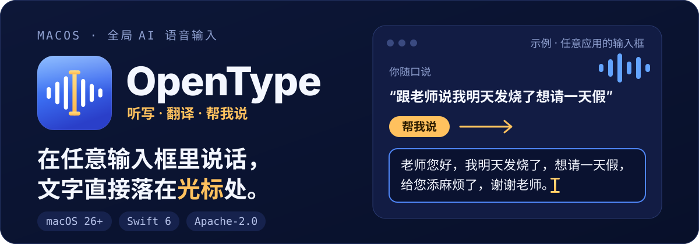
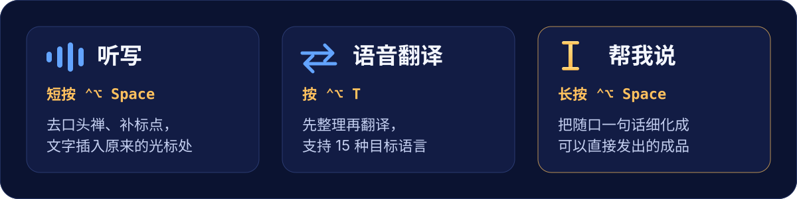

<p align="center">
  
</p>

<p align="center">
  <b>短按快捷键说话，再短按一次结束。</b>语音转写、AI 纠错（去口头禅、补标点）、插入原来的光标位置，一步完成。<br>
  <sub>macOS 26.0+ · Swift 6 / SwiftUI / AppKit · Apache-2.0</sub>
</p>

<p align="center">
  <a href="#三种用法">三种用法</a> ·
  <a href="#安装与首次配置">安装</a> ·
  <a href="#使用">使用</a> ·
  <a href="#隐私与安全">隐私</a> ·
  <a href="OpenType%20PRD.md">产品需求</a>
</p>

## 三种用法

<p align="center">
  
</p>

- **听写**：说完自动去口头禅、补标点，插入到原来的输入位置。
- **语音翻译**：说完先整理再翻译成目标语言，支持 15 种语言；悬浮窗里可临时切换，葡萄牙语（巴西 / 葡萄牙）与繁体中文（台湾 / 港澳）可选地区用语。
- **帮我说**：按住听写快捷键不放（约 0.45 秒后进入），按住说话、松开结束。模型不只是纠错，还会弄清你想表达的意思，把它细化、补全、理顺后再插入。说「跟老师说我明天发烧了想请一天假」，得到的是一段完整、礼貌的请假消息；说「帮我问下这个报错怎么解决」，得到的是目标、条件、期望都清楚的提问。它不会编造你没说过的人名、数字或日期，也不会回答其中的问题。可开启[联网搜索](#帮我说的联网搜索)，让成品融入查到的资料。
- **翻译帮我说**：按住翻译快捷键不放，做同样的事，但成品直接用翻译目标语言写出（悬浮窗里可临时切换语言与地区用语）。联网搜索、读取网页等「帮我说」的全部能力都可用。

## 特性

- **快捷键完全自定义**：单个按键、组合键、单个修饰键（区分左右，如右 ⌥）或 `fn` 均可。
- **不抢焦点**：悬浮窗是非激活式 `NSPanel`，实时显示音量波形和识别文字（已确认文字 + 浅色的未稳定部分）。
- **ASR 与 LLM 解耦**：ASR 可选阿里云百炼 `qwen3-asr-flash-realtime` / `qwen-audio-3.1-asr-flash-message`（实时流式，后者带实时中间结果与可选的识别端润色）或 DeepSeek（录完后整段上传）；LLM 内置 OpenAI Responses、OpenAI Chat Completions、Anthropic Messages 三种协议适配器，兼容第三方 OpenAI 兼容服务；支持多 Profile、三档处理等级（原始 / 标准 / 深度整理）。
- **失败不丢字**：LLM 失败或超时可自动回退为 ASR 原文；ASR 断线时保留已识别内容供复制；`Esc` 随时取消，取消时不会插入任何文字。
- **三级插入**：Accessibility 直写 → 模拟粘贴（自动备份并恢复剪贴板）→ 悬浮窗手动复制。不会向密码框、安全输入模式或已切换的应用写入，也不会自动回车或提交。
- **正式主界面**：原生 SwiftUI 三标签窗口——首页（输入统计与 Token 用量）、历史（可搜索、复制、删除）、设置。
- **隐私优先**：API Key 只存 macOS Keychain；不保存音频；识别文字只存在本机历史中（可随时关闭或清空）；日志不含语音与文字内容。

## 工作流程

```
idle → connecting → recording → finalizing → processing → inserting → idle
```

三种会话共用这条流水线，区别只在最后的 LLM 步骤：听写做纠错整理，翻译做翻译，「帮我说」做整理加细化。

1. **开始**：短按快捷键，记录当前焦点应用与输入控件，弹出悬浮窗并开始采集音频（`AVAudioEngine`，16 kHz / 单声道 / PCM16），流式发送到 ASR。
2. **结束**：再短按一次，停止采集，发送剩余音频和 `session.finish`，等待最终转写，再交给 LLM 整理（原始模式跳过）。
3. **插入**：把结果写回原输入控件，悬浮窗短暂提示后关闭。

「帮我说」的触发方式不同：按下快捷键时先按普通听写开始，若一直按住超过约 0.45 秒，就升级为「帮我说」并转为按住说话，松开快捷键即结束录音；松开得早则仍是普通听写。仅修饰键的快捷键（如 fn）则是长按本身开始会话。

每次会话都有唯一的 Session ID，所有异步回调都会先校验；处理中不允许开始新会话。

## 安装与首次配置

### 1. 构建

需要 Xcode（支持 macOS 26 SDK）。

```bash
git clone https://github.com/KryptonGao/OpenType.git
cd OpenType
open OpenType.xcodeproj
```

在 Xcode 里选择你自己的签名团队后直接运行；或用命令行构建：

```bash
xcodebuild -project OpenType.xcodeproj -scheme OpenType -configuration Release -destination 'platform=macOS' build
```

> 建议使用稳定的开发者证书签名。ad-hoc 签名每次重新构建身份都会变化，系统会让「辅助功能 / 输入监控」授权失效。

### 2. 授权

首次启动后在「设置 → 隐私与权限」里授权，并在系统设置的「隐私与安全性」中打开 OpenType：

| 权限 | 用途 |
|---|---|
| 麦克风 | 采集语音（首次录音时会弹窗） |
| 辅助功能 | 向其他应用的输入框写入文本、模拟粘贴 |
| 输入监控 | 监听全局快捷键 |

授权后快捷键会自动生效。如果开关已打开但仍显示未授权，点「重启 OpenType」；仍无效时，在系统设置列表里删除 OpenType 再重新添加。

### 3. 配置服务

- **语音识别**（设置 → 语音识别）：先选择服务商。
  - 阿里云百炼（实时流式）：选择识别模型（`qwen3-asr-flash-realtime` 或 `qwen-audio-3.1-asr-flash-message`）与区域（北京 / 新加坡），填写 Workspace ID 与 API Key，可点「测试连接」。选 Qwen-Audio 3.1 时可开关「识别端润色：去除语气词与重复语」（默认关，因为后续 LLM 已会处理）。也支持自定义 `wss://` 地址。
  - DeepSeek（整段识别）：只需填写 API Key。该接口不支持流式，录音期间没有实时文字，结束后上传整段 WAV 并返回结果；单次请求最长 120 秒，更长的录音自动分段识别。
- **AI 处理**（设置 → AI 处理）：新建 Profile，选择 API 格式，填写 Base URL、Model ID 和 API Key，可点「测试连接」。Base URL 只允许 `https`，末尾的 `/v1`、`/responses` 等会被规范化，不会重复拼接。还可按 Profile 填写推理强度（effort，留空则不发送）。
- 语音翻译与「帮我说」都使用当前选中的 Profile，即使关闭了 AI 文本后处理或选了原始模式也会调用该模型。「帮我说」输出较长，经常超时时可调大 Profile 的超时秒数。

## 使用

| 操作 | 默认方式 |
|---|---|
| 听写 | 短按 `⌃⌥ Space` 开始，再短按一次结束 |
| 帮我说 | 按住 `⌃⌥ Space`，等悬浮窗显示「帮我说」后说话，松开结束 |
| 翻译帮我说 | 按住 `⌃⌥ T`，等悬浮窗显示「翻译帮我说」后说话，松开结束 |
| 语音翻译 | 按 `⌃⌥ T` 开始，再按一次结束 |
| 取消 | `Esc`（说话或处理过程中均可，取消时不插入任何文字） |

- 快捷键可在「设置 → 通用」里点击录入框直接按下新的按键；翻译快捷键可在「设置 → 翻译」里修改或清除。
- 不方便长按时，可用菜单栏的「开始帮我说」（按一次开始、再按一次结束）；翻译同理，用「开始语音翻译」；「翻译帮我说」用「开始翻译帮我说」。可在「设置 → 帮我说」里关闭长按触发或修改提示词。
- 翻译的目标语言默认取自设置，也可在录音时于悬浮窗里临时切换。翻译失败时不会插入未翻译的文字，识别原文会保留在悬浮窗中供复制。
- 无法自动插入时（密码框、焦点已变化等），结果会显示在悬浮窗里，点「复制文本」即可。
- 菜单栏图标里也可以手动开始 / 结束语音输入、暂停快捷键、查看权限状态。

**关于快捷键**

- 仅修饰键的快捷键（如 fn、右 ⌥）在「松开」时才触发一次，且按住期间没有按其他键或鼠标，避免和 `⌘C`、`⌥` + 点击这类操作冲突；轻点一下即可。
- 不带修饰键的普通字符键会被快捷键独占，建议搭配修饰键；`F1–F20` 不受影响。
- `Esc` 保留为取消键。
- 长按触发「帮我说」对组合键、单个按键和仅修饰键的快捷键都有效；翻译快捷键长按则是「翻译帮我说」，同样适用于各类快捷键。
- 想用 `fn` 的话，请先到「系统设置 → 键盘」把单按 fn 的系统动作改成「无操作」。

### 帮我说的联网搜索

仅支持 DeepSeek，且使用独立的 API Key。默认关闭，在「设置 → 帮我说」中开启并填入 DeepSeek Key 后生效。

- **请求**：「帮我说」与「翻译帮我说」不再使用「AI 处理」选中的 Profile，而是固定请求 `https://api.deepseek.com/chat/completions`、模型 `deepseek-flash`，并声明 DeepSeek 服务端的 `deepseek_web_search` 工具。搜索与网页读取都在 DeepSeek 服务端完成，客户端无需循环调用，是否搜索由模型决定。
- **搜索积极度**：开启思考模式（DeepSeek 的多步“深度搜索”，更愿意主动搜索），改用流式请求，可用滑块调节（0–100%，默认 80%）。

  | 范围 | 行为 |
  |---|---|
  | 0% | 等同关闭 |
  | 1–33% | 保守，不开思考模式 |
  | 34–66% | 适中 |
  | 67–100% | 积极 |

- **反馈**：超时固定 180 秒。搜索过程中悬浮窗实时显示“正在搜索「…」· 已搜到 N 条结果 · 已读取 M 个网页”，插入后提示“已联网搜索：搜索 N 次，共 M 条结果”或“模型未联网搜索”。
- **计费**：按 DeepSeek 联网工具的价格另外计费。
- **失败**：未填 Key 时会报错，而不是悄悄换用别的模型。

## 隐私与安全

- 录音会发送到你选择的语音识别服务（阿里云百炼实时流式，或 DeepSeek 录完后整段上传）；转写文本会发送到你配置的 LLM 服务。除此之外没有任何其他网络请求。
- API Key 仅保存在 Keychain，界面只显示「已保存」，不会读回；不会写入 `UserDefaults`、日志或错误提示。
- 只接受校验证书的 HTTPS / WSS；Workspace ID 经过格式校验，密钥只会发往由它生成的阿里云域名或你明确填写的自定义 `wss://` 地址。
- 不落盘原始音频。识别和整理后的文字默认保存在本机 `~/Library/Application Support/OpenType/history.json`（不上传），可在「历史」页关闭保存或清空；首页统计只用次数、字数、时长和 Token 数。诊断日志默认关闭，开启后也只记录各阶段耗时。

## 开发

<details>
<summary><b>项目结构</b></summary>

```
OpenType/
├── App/            应用入口、AppDelegate、全局对象
├── Core/           会话状态机与协调器、转写聚合器
├── Services/
│   ├── Audio/      AVAudioEngine 采集、重采样与分块
│   ├── ASR/        百炼实时识别 WebSocket 客户端、DeepSeek 整段识别客户端
│   ├── LLM/        三种协议适配器、Prompt（整理 / 翻译 / 帮我说）、错误映射
│   ├── Hotkey/     CGEventTap 全局快捷键（含长按检测）与快捷键配置
│   ├── Insertion/  三级文本插入
│   └── Permissions/ 权限检测与引导
├── Storage/        SettingsStore（UserDefaults）、CredentialStore（Keychain）
├── UI/             菜单栏、悬浮窗、设置窗口
└── Util/           诊断日志
OpenTypeTests/      单元测试
Design/             应用图标与菜单栏图标源文件（SVG）
```

</details>

<details>
<summary><b>运行测试</b></summary>

```bash
xcodebuild -project OpenType.xcodeproj -scheme OpenType -destination 'platform=macOS' test
```

测试覆盖转写聚合、ASR 配置与 `session.update` 内容、三种 LLM 协议的请求与响应解析及错误映射、快捷键状态机与长按检测、设置存储，以及用假音频 / ASR / LLM / 插入组件驱动的端到端会话流程（成功、回退、取消、各类失败，以及翻译与「帮我说」）。

</details>

## 路线图

- 自定义词典 / 热词、多 Prompt 预设
- 应用级规则
- 更多语音模型 / 本地 ASR、多语言界面
- 全场景兼容性验证（Safari / Chrome / VS Code / Electron / IM / 全屏 / 多屏 / 输入法切换）与 Developer ID 签名、公证

不在范围内：账号与云同步、订阅计费、自建推理服务、非 macOS 平台、多人会议与说话人分离。

产品需求详见 [OpenType PRD.md](OpenType%20PRD.md)。

## 许可证

[Apache License 2.0](LICENSE)
