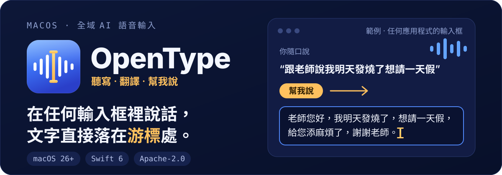
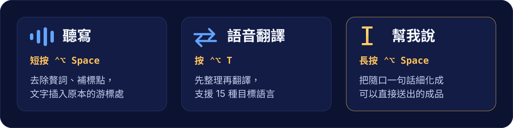

<p align="center">
  <a href="README.md">English</a> ·
  <a href="README.zh-Hans.md">简体中文</a> ·
  <b>繁體中文</b> ·
  <a href="README.ja.md">日本語</a> ·
  <a href="README.ko.md">한국어</a>
</p>

<p align="center">
  
</p>

<p align="center">
  <b>短按快速鍵開始說話，再短按一次結束。</b>語音轉寫、AI 修正（去除贅詞、補上標點）、插入原本的游標位置，一步完成。<br>
  <sub>macOS 26.0+ · Swift 6 / SwiftUI / AppKit · Apache-2.0</sub>
</p>

<p align="center">
  <a href="#三種用法">三種用法</a> ·
  <a href="#安裝與首次設定">安裝</a> ·
  <a href="#使用">使用</a> ·
  <a href="#隱私與安全">隱私</a> ·
  <a href="docs/README.md">文件（英文）</a> ·
  <a href="OpenType%20PRD.md">產品需求（簡體中文）</a>
</p>

## 三種用法

<p align="center">
  
</p>

- **聽寫**：說完自動去除贅詞、補上標點，插入到原本的輸入位置。
- **語音翻譯**：說完先整理再翻譯成目標語言，支援 15 種語言；懸浮視窗中可暫時切換，葡萄牙語（巴西／葡萄牙）與繁體中文（台灣／港澳）可選擇地區用語。
- **幫我說**：按住聽寫快速鍵不放（約 0.45 秒後進入），按住說話、放開結束。模型不只是修正文字，還會弄清楚你想表達的意思，將它細化、補全、理順後再插入。說「跟老師說我明天發燒了想請一天假」，會得到一段完整、禮貌的請假訊息；說「幫我問一下這個錯誤訊息怎麼解決」，會得到目標、條件、期望都清楚的提問。它不會編造你沒說過的人名、數字或日期，也不會回答其中的問題。可開啟[網路搜尋](#幫我說的網路搜尋)，讓成品融入查到的資料。
- **翻譯幫我說**：按住翻譯快速鍵不放，做同樣的事，但成品直接以翻譯目標語言寫出（懸浮視窗中可暫時切換語言與地區用語）。網路搜尋、讀取網頁等「幫我說」的全部功能都可使用。

## 特色

- **多語言介面**：简体中文、繁體中文（台灣）、English、日本語、한국어；預設跟隨系統語言，系統語言不在其中時使用英文，也可在「設定 → 一般」中手動選擇。
- **快速鍵完全自訂**：單一按鍵、組合鍵、單一修飾鍵（區分左右，如右 ⌥）或 `fn` 皆可。
- **不搶焦點**：懸浮視窗是非啟用式的 `NSPanel`，即時顯示音量波形與辨識文字（已確認文字加上顏色較淡的未穩定部分）。
- **ASR 與 LLM 解耦**：ASR 可選阿里雲百鍊 `qwen3-asr-flash-realtime` / `qwen-audio-3.1-asr-flash-message`（即時串流，後者附即時中間結果與可選的辨識端潤飾）或 DeepSeek（錄完後整段上傳）；LLM 內建 OpenAI Responses、OpenAI Chat Completions、Anthropic Messages 三種協定的轉接器，相容第三方 OpenAI 相容服務；支援多個設定檔、三檔處理等級（原始／標準／深度整理）。
- **失敗不丟字**：LLM 失敗或逾時時可自動回退為 ASR 原文；ASR 斷線時保留已辨識的內容供複製；`Esc` 隨時取消，取消時不會插入任何文字。
- **三級插入**：輔助使用直接寫入 → 模擬貼上（自動備份並還原剪貼簿）→ 在懸浮視窗中手動複製。不會向密碼欄位、安全輸入模式或已切換的 App 寫入，也不會自動按下 Return 或送出。
- **正式主視窗**：原生 SwiftUI 四分頁視窗——首頁（輸入統計與 Token 用量）、歷史（可搜尋、複製、刪除）、詞典、設定。
- **面向程式設計師的詞典**：內建程式通用詞彙、Git，以及 Swift / Python / JavaScript 與 TypeScript / Shell / SQL / HTML 與 CSS 的關鍵字和常用函式，還有 AI 概念（Agent Harness、MCP、RAG 等）與廠商產品（OpenAI、Anthropic、DeepSeek 等）。每個詞庫可單獨開關，也可以新增自己的詞條（正確寫法 + 常被聽錯的說法）。語音裡提到詞典中的詞時，會告訴 AI 正確寫法；開啟「自動替換」的詞條還會在 AI 處理之前直接修正辨識結果，所以關閉 AI 整理（原文模式）時同樣有效。
- **隱私優先**：API Key 以純文字 JSON 存於 `~/.opentype/credentials.json`（權限 0600，升級後不再跳出鑰匙圈密碼提示）；不儲存音訊；辨識文字只存在本機歷史中（可隨時關閉或清除）；日誌不含語音與文字內容。

## 工作流程

```
idle → connecting → recording → finalizing → processing → inserting → idle
```

三種工作階段共用這條流程，差別只在最後的 LLM 步驟：聽寫做修正整理，翻譯做翻譯，「幫我說」做整理加細化。

1. **開始**：短按快速鍵，記錄目前焦點所在的 App 與輸入元件，彈出懸浮視窗並開始收音（`AVAudioEngine`，16 kHz／單聲道／PCM16），串流傳送到 ASR。
2. **結束**：再短按一次，停止收音，傳送剩餘音訊與 `session.finish`，等待最終轉寫，再交給 LLM 整理（原始模式會略過）。
3. **插入**：把結果寫回原輸入元件，懸浮視窗短暫提示後關閉。

「幫我說」的觸發方式不同：按下快速鍵時先以一般聽寫開始，若持續按住超過約 0.45 秒，就升級為「幫我說」並轉為按住說話，放開快速鍵即結束錄音；放開得早則仍是一般聽寫。僅修飾鍵的快速鍵（如 fn）則是長按本身開始工作階段。

每個工作階段都有唯一的 Session ID，所有非同步回呼都會先驗證；處理中不允許開始新的工作階段。

## 安裝與首次設定

### 1. 建置

需要 Xcode（支援 macOS 26 SDK）。

```bash
git clone https://github.com/KryptonGao/OpenType.git
cd OpenType
open OpenType.xcodeproj
```

在 Xcode 中選擇你自己的簽署團隊後直接執行；或用命令列建置：

```bash
xcodebuild -project OpenType.xcodeproj -scheme OpenType -configuration Release -destination 'platform=macOS' build
```

> 建議使用穩定的開發者憑證簽署。ad-hoc 簽署每次重新建置身分都會改變，系統會讓「輔助使用／輸入監控」的授權失效。

### 2. 授權

首次啟動後，在「設定 → 隱私與權限」中授權，並在系統設定的「隱私權與安全性」中開啟 OpenType：

| 權限 | 用途 |
|---|---|
| 麥克風 | 收錄語音（首次錄音時會跳出視窗詢問） |
| 輔助使用 | 向其他 App 的輸入框寫入文字、模擬貼上 |
| 輸入監控 | 監聽全域快速鍵 |

授權後快速鍵會自動生效。如果開關已開啟但仍顯示未授權，請點「重新啟動 OpenType」；仍無效時，在系統設定的清單中移除 OpenType 再重新加入。

### 3. 設定服務

- **語音辨識**（設定 → 語音辨識）：先選擇服務商。
  - 阿里雲百鍊（即時串流）：選擇辨識模型（`qwen3-asr-flash-realtime` 或 `qwen-audio-3.1-asr-flash-message`）與區域（北京／新加坡），填寫 Workspace ID 與 API Key，可點「測試連線」。選 Qwen-Audio 3.1 時可切換「辨識端潤飾：去除語氣詞與重複語」（預設關閉，因為後續 LLM 已會處理）。也支援自訂 `wss://` 位址。
  - DeepSeek（整段辨識）：只需填寫 API Key。該介面不支援串流，錄音期間沒有即時文字，結束後上傳整段 WAV 並回傳結果；單次請求最長 120 秒，更長的錄音會自動分段辨識。
- **AI 處理**（設定 → AI 處理）：新增設定檔，選擇 API 格式，填寫 Base URL、Model ID 與 API Key，可點「測試連線」。Base URL 只允許 `https`，結尾的 `/v1`、`/responses` 等會被正規化，不會重複串接。還可依設定檔填寫推理強度（effort，留空則不送出）。
- 語音翻譯與「幫我說」都使用目前選取的設定檔，即使關閉了 AI 文字後處理或選了原始模式，也會呼叫該模型。「幫我說」輸出較長，若經常逾時，可調高設定檔的逾時秒數。

## 使用

| 操作 | 預設方式 |
|---|---|
| 聽寫 | 短按 `⌃⌥ Space` 開始，再短按一次結束 |
| 幫我說 | 按住 `⌃⌥ Space`，等懸浮視窗顯示「幫我說」後說話，放開結束 |
| 翻譯幫我說 | 按住 `⌃⌥ T`，等懸浮視窗顯示「翻譯幫我說」後說話，放開結束 |
| 語音翻譯 | 按 `⌃⌥ T` 開始，再按一次結束 |
| 取消 | `Esc`（說話或處理過程中皆可，取消時不插入任何文字） |

- 快速鍵可在「設定 → 一般」中點選輸入框後直接按下新的按鍵；翻譯快速鍵可在「設定 → 翻譯」中修改或清除。
- 可在「設定 → 幫我說」中關閉長按觸發或修改提示詞。
- 翻譯的目標語言預設取自設定，也可在錄音時於懸浮視窗中暫時切換。翻譯失敗時不會插入未翻譯的文字，辨識原文會保留在懸浮視窗中供複製。
- 無法自動插入時（密碼欄位、焦點已改變等），結果會顯示在懸浮視窗中，點「複製文字」即可。
- 選單列圖示可查看聽寫／翻譯快速鍵、暫停快速鍵、查看權限狀態，並開啟主視窗、歷史記錄與設定。

**關於快速鍵**

- 僅修飾鍵的快速鍵（如 fn、右 ⌥）在「放開」時才觸發一次，且按住期間沒有按其他鍵或滑鼠，以避免和 `⌘C`、`⌥` + 點擊這類操作衝突；輕點一下即可。
- 不帶修飾鍵的一般字元鍵會被快速鍵獨佔，建議搭配修飾鍵；`F1–F20` 不受影響。
- `Esc` 保留為取消鍵。
- 長按觸發「幫我說」對組合鍵、單一按鍵和僅修飾鍵的快速鍵都有效；翻譯快速鍵長按則是「翻譯幫我說」，同樣適用於各類快速鍵。
- 想使用 `fn` 的話，請先到「系統設定 → 鍵盤」把單按 fn 的系統動作改成「不執行任何動作」。

### 幫我說的網路搜尋

僅支援 DeepSeek，且使用獨立的 API Key。預設關閉，在「設定 → 幫我說」中開啟並填入 DeepSeek Key 後生效。

- **請求**：「幫我說」與「翻譯幫我說」不再使用「AI 處理」選取的設定檔，而是固定請求 `https://api.deepseek.com/chat/completions`、模型 `deepseek-flash`，並宣告 DeepSeek 伺服器端的 `deepseek_web_search` 工具。搜尋與網頁讀取都在 DeepSeek 伺服器端完成，用戶端無需迴圈呼叫，是否搜尋由模型決定。
- **搜尋積極度**：開啟思考模式（DeepSeek 的多步驟「深度搜尋」，更願意主動搜尋），改用串流請求，可用滑桿調整（0–100%，預設 80%）。

  | 範圍 | 行為 |
  |---|---|
  | 0% | 等同關閉 |
  | 1–33% | 保守，不開思考模式 |
  | 34–66% | 適中 |
  | 67–100% | 積極 |

- **回饋**：逾時固定 180 秒。搜尋過程中懸浮視窗即時顯示「正在搜尋「…」· 已搜尋到 N 筆結果 · 已讀取 M 個網頁」，插入後提示「已網路搜尋：搜尋 N 次，共 M 筆結果」或「模型未使用網路搜尋」。
- **計費**：依 DeepSeek 網路工具的價格另外計費。
- **失敗**：未填 Key 時會顯示錯誤，而不是悄悄改用別的模型。

## 隱私與安全

- 錄音會傳送到你選擇的語音辨識服務（阿里雲百鍊即時串流，或 DeepSeek 錄完後整段上傳）；轉寫文字會傳送到你設定的 LLM 服務。除此之外沒有任何其他網路請求。
- API Key 以純文字 JSON 儲存在 `~/.opentype/credentials.json`（目錄 0700、檔案 0600），介面只顯示「已儲存」，不會讀回；不會寫入 `UserDefaults`、日誌或錯誤訊息。舊版本留在鑰匙圈裡的 Key 會在首次啟動時自動遷移。
- 只接受驗證憑證的 HTTPS / WSS；Workspace ID 經過格式驗證，金鑰只會傳送到由它產生的阿里雲網域，或你明確填寫的自訂 `wss://` 位址。
- 不將原始音訊寫入磁碟。辨識與整理後的文字預設儲存在本機 `~/Library/Application Support/OpenType/history.json`（不上傳），可在「歷史」頁面關閉儲存或清除；首頁統計只使用次數、字數、時長與 Token 數。診斷日誌預設關閉，開啟後也只記錄各階段耗時。

## 開發

<details>
<summary><b>專案結構</b></summary>

```
OpenType/
├── App/            App 進入點、AppDelegate、全域物件
├── Core/           工作階段狀態機與協調器、轉寫聚合器
├── Services/
│   ├── Audio/      AVAudioEngine 收音、重取樣與分塊
│   ├── ASR/        百鍊即時辨識 WebSocket 用戶端、DeepSeek 整段辨識用戶端
│   ├── LLM/        三種協定轉接器、Prompt（整理／翻譯／幫我說）、錯誤對應
│   ├── Hotkey/     CGEventTap 全域快速鍵（含長按偵測）與快速鍵設定
│   ├── Insertion/  三級文字插入
│   └── Permissions/ 權限偵測與引導
├── Storage/        SettingsStore（UserDefaults）、CredentialStore（`~/.opentype/credentials.json`）
├── UI/             選單列、懸浮視窗、設定視窗
└── Util/           診斷日誌
OpenTypeTests/      單元測試
Design/             App 圖示與選單列圖示來源檔（SVG）
```

</details>

<details>
<summary><b>執行測試</b></summary>

```bash
xcodebuild -project OpenType.xcodeproj -scheme OpenType -destination 'platform=macOS' test
```

測試涵蓋轉寫聚合、ASR 設定與 `session.update` 內容、三種 LLM 協定的請求與回應解析及錯誤對應、快速鍵狀態機與長按偵測、設定儲存，以及以假音訊／ASR／LLM／插入元件驅動的端到端工作階段流程（成功、回退、取消、各類失敗，以及翻譯與「幫我說」）。

</details>

## 路線圖

- 多組 Prompt 預設、詞典匯入匯出、用詞典為語音辨識增強偏置
- App 層級規則
- 更多語音模型／本機 ASR
- 全情境相容性驗證（Safari / Chrome / VS Code / Electron / 通訊軟體 / 全螢幕 / 多螢幕 / 輸入法切換）與 Developer ID 簽署、公證

不在範圍內：帳號與雲端同步、訂閱計費、自建推論服務、非 macOS 平台、多人會議與說話者分離。

產品需求詳見 [OpenType PRD.md](OpenType%20PRD.md)（簡體中文）。

## 授權條款

[Apache License 2.0](LICENSE)
